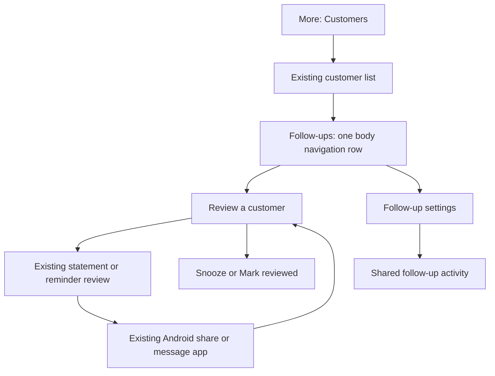

# Phase 6 UI: one follow-up workspace

16 October 2026. This is a planned layout, not a rendered/accepted Android implementation. Native acceptance belongs to pieces A/B. Reuse the inspected phase 5 UI and its [existing design authority](../../2026-10-15/statements-plan/UI_FIT.md): bundled Manrope, SaafTheme, native visual roles, NativeInformationSection/Heading/Fact, Navigation/Entity list styles, shared role scaffold and NativeSectionTransition. No new palette, capsule language, bottom tab, landscape layout or whole-app menu audit.

## Placement



Keep the fixed top title **Customers** and the existing bottom bar on these nested panes; body titles identify Follow-ups, Follow-up settings and Review follow-up. Notification taps open Follow-ups after ordinary authentication/authorization. Hardware/body Back follows that stack; return from a message app retains the current review, not a new dashboard.

The customer-list body receives one deliberate Follow-ups navigation row before its search/filter controls. Its subtitle gives the persistent pending count/state even when Android notifications are blocked. Keep that row when the count is zero so refresh does not insert/remove a block above the list. The existing More Customers row may show a trailing accessible attention indicator in a reserved slot, without replacing its subtitle or changing row height. No combined credit/sync count that hides which problem needs attention.

## Follow-ups body

```text
[existing fixed Customers header]
Back to customers
Follow-ups                          Settings
Checked today, 10:12 · Up to date / Sync needed
[reserved progress/status area]

[ All ] [ Statements ] [ Overdue ] [ Check records ]
Search customers

[ Amina's cafe                         PKR 1,250.00 ]
[ Statement ready · Known overdue PKR 250.00       ]
[ Last reviewed 9 Oct                    Review >  ]

[existing fixed role navigation]
```

One Entity-style row per customer. Name is the primary title, outstanding is the metric role, reason is a labeled status, and date/last review are supporting text. Wrap long values; at large text put amount under the name rather than squeezing or truncating PKR. Text/icon conveys status as well as color. Sort Check records first, then overdue by oldest supported overdue age, then statement reviews by scheduled date/name. Filters change body content without remounting chrome; counts are a union of customers, not summed overlapping reasons.

Use a single short freshness line and an in-context explanation when synchronization is needed. A generic notification reads **Credit follow-ups need review** / **Open the app to check current records**; no customer names or money on the lock screen. Clear-empty state: **No follow-ups need review** with the next planned review. Paused/snoozed entries are available through a quiet View postponed action, not extra permanent tabs. Initial loading, errors, retry and denied-notification explanation retain their action/progress regions.

## Customer review body

Group the current facts once: customer, outstanding, supported overdue amount, reason for today's task, freshness and last shared review. Do not repeat Owner risk labels in a customer message or duplicate the whole credit-management panel. One filled **Prepare statement** or **Prepare reminder** action follows the reason; the other is lower emphasis. Reuse the already implemented preview, recipient confirmation, format choice and message text. No new message editor, batch Send all or automatic external-app opening.

Snooze uses Tomorrow / Next week / Choose date. Mark reviewed records an acknowledgment and displays its next review date; never label it Paid or Sent. After an external handoff, show **Composer opened; sending is not confirmed**, with **Mark reviewed** and **Review again**. An unresolved handoff on another phone has a clear explanation instead of an active second launch. Retry after uncertainty requires explicit confirmation. In coordinated offline mode show **Connect to check whether another phone is handling this customer** beside the disabled external handoff; draft/statement review and ordinary sales stay usable.

Customer-specific Schedule & pause is a disclosure inside the existing Statements & reminders task. Show **Payment terms** and **Statement schedule** with distinct labels; editing the latter never changes the former. Select Use shop schedule / Weekly / Monthly / Custom interval / Paused. Show only the selected method's fields, with explanatory examples. Use accepted native date/time fields without autofocus; changed preferences use the normal save/error/leave guard.

## Settings body

Three coherent information groups, not a long plain-text option list:

1. **Owner attention:** enabled switch, primary phone, Around [time], quiet hours, notification permission/channel status. Transfer phone has an explicit connected confirmation and stable saving/error slot.
2. **Review schedule:** Sunday default statement review, overdue follow-up interval and shop timezone. Explain **Statement timing does not change payment deadlines**. Customer overrides are edited with the customer, not in a second global list of everyone.
3. **Customer contact:** current mode **Review and send manually**. Automatic SMS is **Not configured** until piece C records a viable route; do not ship a toggle that implies working unattended sending. Shared follow-up activity is a quiet secondary entry here. Keep phase 5 Preparation history labeled local; do not relabel/import it as shared sending history.

**Wi-Fi-only device fallback:** do not equate Primary notification device with SMS sender. WhatsApp may work as a linked tablet app; SMS may open a linked messaging app without local telephony. Label each as an external handoff, never guaranteed sending. If a handler fails, preserve the draft and offer the available other channel, existing statement sharing, or continuing the shared customer review on the shop phone. Do not always prescribe SMS when WhatsApp fails. Do not add an automatic relay/pairing screen or a new tablet navigation/layout in this scope. A one-draft recipient override stays private to the device/draft and must be reentered/confirmed if continuing elsewhere.

## Geometry and feedback rules

- Existing NativeListStyle dimensions/padding own each surface once: 16dp page gutters, normal native section/entity insets, 12–16dp within groups and 24dp between different tasks. Do not nest another capsule around every line or put action text against its border.
- Same type roles as phase 5: section 16sp/22 semibold, value 16sp/24 semibold, support 14sp/20 medium, money metric 16sp/24 bold; short body title uses existing titleLarge. Light/dark colors come from native tokens. At 200%, controls and full amounts reflow into a vertical body scroll; no shrinking fonts or resizing header/footer.
- Existing 48dp minimum actions and haptic callbacks. Heading actions move below the title at large text using NativeInformationHeading. Reserve the 4dp progress slot. Keep final action/error/confirmation readable; no instantly disappearing success page or whole-page size animation.
- Use the existing body crossfade only when pane identity changes; no crossfade for each data update, filter or worker tick. Keep prior facts visibly stale while refreshing and disable consequential handoff until checked.
- One IME inset owner for the edited body, no surprise focus, existing dirty-draft guard on Back/navigation. Test customer schedule/custom-date inputs only if introduced in piece A; do not restart an all-text-box audit.

Acceptance captures: follow-up list with long names/large amounts/overlapping reasons, settings, customer schedule and changed/uncertain handoff in light/default and dark/200%; empty/offline/permission-denied states. Compare fixed header/footer bounds before/after navigation, filter, save and return. These are affected screens only. The existing footer-label observation stays in the phase 5 LATER note, not this design scope.
